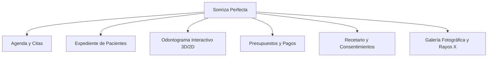

# Sistema de Gestión Odontológica — "Sonriza Perfecta"

Documento de especificación, arquitectura funcional y módulos recomendados para la aplicación de escritorio (`.exe`).

---

## 1. Módulos Esenciales Recomendados

Para que la doctora tenga una herramienta completa, profesional y fácil de usar, la aplicación se estructura en los siguientes módulos:

### 1.1. Agenda y Control de Citas
* **Vista Calendario**: Modos día, semana y mes con bloques horarios configurables.
* **Estados de la cita**: Programada, Confirmada, En Sala de Espera, En Atención, Finalizada, Cancelada, No asistió.
* **Integración con WhatsApp**: Botón de un solo clic que abre WhatsApp con el mensaje pre-redactado:
  > *"Hola [Nombre del Paciente], le recordamos su cita odontológica en Sonriza Perfecta el día [Fecha] a las [Hora]. Por favor confirme su asistencia."*
* **Motivo de consulta**: Limpieza, dolor/urgencia, valoración, ortodoncia, cirugía, etc.

---

### 1.2. Ficha Médica y Expediente de Pacientes
* **Datos Generales**: Nombres, documento de identidad, teléfono, WhatsApp, correo, fecha de nacimiento, ocupación y contacto de emergencia.
* **Anamnesis Médica Crítica**:
  * Alergias (Penicilina, Látex, Anestesia local, etc. con alertas visuales rojas).
  * Enfermedades sistémicas (Hipertensión, Diabetes, Cardiopatías, Coagulopatías).
  * Medicamentos de uso regular.
  * Estado de embarazo / lactancia.
* **Línea de Tiempo Clínica**: Registro cronológico de cada visita con fecha, motivo, diagnóstico, tratamiento ejecutado y doctor a cargo.

---

### 1.3. Odontograma Interactivo (Pieza Central del Sistema)
* **Mapeo Anatómico Completo (Sistema FDI)**:
  * **Arcada Superior**: 18 a 11 (Cuadrante 1 - Derecha) y 21 a 28 (Cuadrante 2 - Izquierda).
  * **Arcada Inferior**: 48 a 41 (Cuadrante 4 - Derecha) y 31 a 38 (Cuadrante 3 - Izquierda).
  * Incluye incisivos, caninos, premolares, molares y **cordales / muelas del juicio (18, 28, 38, 48)**.
* **Interacción por Caras Dentales**:
  * Oclusal/Incisal (centro).
  * Vestibular (exterior).
  * Palatina/Lingual (interior).
  * Mesial y Distal (laterales).
* **Convención de Colores Odontológicos**:
  | Color | Significado |
  | :--- | :--- |
  | 🔴 **Rojo** | Caries / Patología activa / Tratamiento requerido |
  | 🔵 **Azul** | Tratamiento ya realizado / Resina u obturación en buen estado |
  | 🟡 **Amarillo/Naranja** | Endodoncia / Tratamiento de conducto necesario o realizado |
  | 🟣 **Morado** | Prótesis fija / Corona / Implante |
  | ⚫ **Gris/Cruz** | Pieza ausente / Indicación de exodoncia (extracción) |
  | 🟢 **Verde** | Sellantes preventivos / Limpieza |
* **Modal de Detalle por Diente**:
  * Al hacer clic en un diente o cordal se abre su historial individual.
  * Permite asignar diagnósticos específicos, plan de tratamiento, notas clínicas del procedimiento y costo.

---

### 1.4. Presupuestos, Cobros y Planes de Tratamiento
* **Catálogo de Procedimientos**: Lista editable de precios (Profilaxis, Resina, Blanqueamiento, Exodoncia simple, Cirugía de cordales, Endodoncia, Ortodoncia, etc.).
* **Presupuesto por Paciente**: Selección de tratamientos a partir de lo marcado en el odontograma.
* **Control de Abonos y Saldos**:
  * Historial de pagos (Efectivo, Transferencia, Tarjeta, etc.).
  * Balance pendiente de cobro en tiempo real.
  * Generación de comprobante/recibo para imprimir o exportar en PDF.

---

### 1.5. Recetario y Consentimientos Informados
* **Emisión de Recetas / Récipes**: Formato membretado con el logo de "Sonriza Perfecta", datos del paciente, medicamentos recetados (dosis, frecuencia, duración) e indicaciones.
* **Consentimientos Informados**: Plantillas listas para imprimir y firmar para cirugías (ej. extracción de cordales, endodoncia, implantes).

---

### 1.6. Almacén de Radiografías y Fotografías Clínicas
* Carga de radiografías periapicales, panorámicas y fotos intraorales del paciente (Antes / Después).
* Comparativa visual del avance del tratamiento.

---

## 2. Opciones de Arquitectura para el `.exe`

| Característica | **Opción A: Electron Desktop App (Recomendada)** | **Opción B: Python Desktop (PyWebView/PyQt)** |
| :--- | :--- | :--- |
| **Diseño Visual** | Ultra moderno, fluido, interactivo con SVG/Canvas de alta definición | Moderno, pero con limitaciones de animación y gráficos vectoriales nativos |
| **Odontograma** | Interactivo en tiempo real (clic por cara y pieza con microanimaciones) | Más pesado de renderizar interactivamente |
| **Base de Datos** | SQLite local embebido (rápido, no requiere servidor ni internet) | SQLite local con SQLAlchemy o SQLite3 |
| **Empaquetado** | Genera instalador `.exe` o ejecutable portable con `electron-builder` | Empaquetado con `pyinstaller` |
| **Requisitos usuario** | Cero configuración; hace doble clic en el `.exe` y funciona | Cero configuración; standalone `.exe` |
